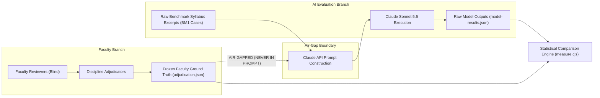

# AI COMPARISON PREPARATION SPECIFICATION
**LCUP Syllabus Management System — Hybrid AI Checker**  
**Technical Execution Protocol for Authorized Model Evaluation (Policy V2)**

---

## 1. PURPOSE & PRE-REQUISITE CONDITIONS

This specification establishes the technical execution protocol for evaluating Anthropic's Claude API against the frozen faculty reference ground truth across the 21 validation cases.

> [!CAUTION]
> **Pre-Execution Gates (Must Be Met Before Any API Call)**:
> 1. Faculty reference judgments for all 21 cases must be fully adjudicated and frozen in `adjudication.json`.
> 2. VPAA Decision 14b (Approval for External AI Data Transmission) must be formally approved in writing.
> 3. Zero live API requests are to be dispatched until Gates 1 and 2 are satisfied.

---

## 2. EVALUATION CONFIGURATION & VERSION LOCKING

To ensure strict reproducibility, all evaluation parameters are version-locked:

| Configuration Dimension | Approved Specification | System Reference / Identifier |
| :--- | :--- | :--- |
| **Target AI Model** | Anthropic Claude Sonnet 5.5 | `claude-sonnet-5-5` |
| **Adapter Interface** | Anthropic Messages API Adapter | `server/lib/syllabuscheck/anthropicClient.js` |
| **System Policy Version** | Academic Policy V2 Preview 1 | `academic-evaluation-v2-preview-1` |
| **System Prompt Version** | Policy V2 Integrated Prompt | `promptVersion: 'academic-evaluation-v2-preview-1'` |
| **Evaluation Dataset** | LCUP Academic Benchmark v1 | `lcup-academic-benchmark-1` (Hash: `ebd12920...bbf7`) |
| **Sampling Scope** | 21 Sampled Institutional Cases | `FV-01` through `FV-21` |
| **Inference & Token Bounds** | Standard API Parameters | Sampling parameters omitted (API v2026-10-21); `max_tokens: 16000` |
| **Production State** | Disabled by Default | `SYLLABUS_CHECK_ACADEMIC_V2=off` |

---

## 3. STRICT AIR-GAP & DATA PROTECTION ARCHITECTURE

To prevent prompt contamination, confirmation bias, or accidental data leakage:



### Protocol Safeguards
1. **Zero Exposure of Faculty Answers**: Prompts submitted to Claude contain strictly the course title, description, CLO definitions, and the specific two statements under evaluation. Faculty justifications, ratings, and corrections are **never** included in API requests.
2. **Minimal Excerpt Transmission**: Only the isolated textual statements necessary for the relationship evaluation are transmitted over encrypted TLS. No faculty names, instructor IDs, or institutional metadata are sent.
3. **Enterprise Non-Training Terms**: Dispatches must utilize standard enterprise API endpoints that guarantee customer data is not retained for model training.

---

## 4. API LIMITS, BUDGET CEILINGS & DEFENSE CONTROLS

The evaluation execution harness enforces three layers of software-defined safety bounds:

1. **Monetary Spending Bounds & Cumulative Reservation Modeling**:
   - **Model Pricing (`claude-sonnet-5-5`)**: \$2.00 per million input tokens, \$10.00 per million output tokens, \$0.10 per million cache read tokens.
   - **Output Token Bound Preservation**: `max_tokens: 16000` is preserved. Truncating `max_tokens` below 8,192 is unsafe because complex academic judgments—including verbatim syllabus quotations, cognitive Bloom classification mappings, comprehensive pedagogic gap explanations, and complete replacement text for entire syllabus topics or ILO sets—require adequate output capacity. Under adaptive thinking, `max_tokens` also covers internal reasoning tokens; premature limits trigger `stop_reason: "max_tokens"` and unverified rejections.
   - **Cumulative Reservation Mechanics**:
     Before dispatching any request, [`providerGuard.js`](file:///C:/Users/JP%20Del%20Rosario/Syllabus-Repository/server/lib/syllabuscheck/eval/providerGuard.js) evaluates:
     $$\text{ledger.charged} + \text{state.reserved} + \text{worst.dollars} \le \text{maxCost}$$
     At `max_tokens: 16000`, the worst-case reservation per request is **\$0.1918 USD**.
     When cumulative settled charges reach $\text{maxCost} - \$0.1918$, the guard halts further dispatches.
   - **Defect Analysis of the \$0.50 Budget Cap**:
     - Under a \$0.50 cap, execution halts once settled spend reaches **\$0.3082 USD**.
     - With 32 authorized requests (21 primary cases + 11 retries), even with thinking off (~\$0.011 settled per request), cumulative charges reach \$0.3190 at request 29, causing a premature halt at request 30.
     - If a single network timeout occurs, [`providerGuard.js`](file:///C:/Users/JP%20Del%20Rosario/Syllabus-Repository/server/lib/syllabuscheck/eval/providerGuard.js) charges the full worst case (\$0.1918) to the ledger, causing premature exhaustion after only 12 requests.
     - In adaptive thinking mode (~\$0.0319 settled per request), cumulative charges hit \$0.3190 at request 10, halting execution on Case 11 of 21.
   - **Corrected Institutional Budget Authorizations**:
     - **Thinking-Off Mode (`ANTHROPIC_THINKING=off`)**: Requires an institutional budget cap of **\$1.00 USD** (minimum \$0.75 USD) to ensure up to 32 requests execute cleanly and withstand transient timeouts.
     - **Adaptive Thinking Mode (`ANTHROPIC_THINKING=adaptive`, effort `high`)**: Requires an institutional spending authorization of **\$1.50 USD** (with a safety register cap of **\$2.00 USD**) to accommodate full 32-request reasoning depth and reserve headroom.
2. **Evaluation Repeatability & Non-Determinism Limitations**:
   - In Anthropic API version 2026-10-21, sampling parameters (`temperature`, `top_p`, `top_k`) are completely omitted from the request body.
   - Setting `ANTHROPIC_THINKING=off` maps to `thinking: { type: 'between_tools' }` on Sonnet 5.5, which disables extended reasoning scratchpads, but **does not guarantee bit-for-bit deterministic output**. Floating-point non-associativity across parallel GPU clusters, dynamic batching, and distributed inference kernels introduce inherent variance.
   - Repeatability is guaranteed architecturally through:
     1. Rigid configuration locking (`model: 'claude-sonnet-5-5'`, `effort: 'high'`, fixed JSON schema).
     2. Strict benchmark dataset freezing via content hash (`ebd12920...bbf7`).
     3. Systematic deduplication fingerprints ([`configKeyOf`](file:///C:/Users/JP%20Del%20Rosario/Syllabus-Repository/server/lib/syllabuscheck/anthropicClient.js#L62-L65) / `pairKey`).
     4. Append-only evaluation ledgers (`ledger.entries`) and offline replay harnesses ([`academicV2Replay.js`](file:///C:/Users/JP%20Del%20Rosario/Syllabus-Repository/server/lib/syllabuscheck/academicV2Replay.js)).
3. **Request Ceiling**:
   `SYLLABUS_CHECK_AI_MAX_REQUESTS=32`
   Restricts the batch execution to a maximum of 32 total requests (21 primary cases plus a maximum of 11 retries/splits for unverified responses).
4. **Token Ceiling**:
   `SYLLABUS_CHECK_AI_MAX_TOKENS=800000`
   Limits total token throughput to prevent runaway prompt expansions.
5. **Retry Boundaries**:
   Zero recursive calling. Transient HTTP 5xx or rate-limit responses are bounded by `ANTHROPIC_MAX_RETRIES=2` with exponential backoff. Validation retries are bounded by `SINGLE_RETRIES=2`.

---

## 5. CASE IDENTIFIER BINDING & BENCHMARK MAPPING

Every evaluation request preserves exact bidirectional traceability between reviewer case IDs (`FV-xx`) and benchmark reference IDs (`BM1-xxx`):

| Faculty Case ID | Benchmark Case ID | Course | Relationship Key | Pair ID |
| :---: | :---: | :---: | :--- | :--- |
| `FV-01` | `BM1-IT202-130` | IT 202 | `Content-activity` | `row0-contentactivity` |
| `FV-02` | `BM1-IT202-104` | IT 202 | `Content-ILO` | `row3-ilo1-contentilo` |
| `FV-03` | `BM1-IT202-141` | IT 202 | `Activity-assessment` | `row3-activityassessment` |
| `FV-04` | `BM1-IT202-064` | IT 202 | `ILO-CLO` | `row6-ilo0-clo:it202_clo3` |
| `FV-05` | `BM1-IT202-155` | IT 202 | `Content-assessment` | `row10-contentassessment` |
| `FV-06` | `BM1-IT202-122` | IT 202 | `Content-course` | `row11-content` |
| `FV-07` | `BM1-IT202-093` | IT 202 | `ILO-activity` | `row11-ilo1-activity` |
| `FV-08` | `BM1-IE402-073` | IE-402 | `Content-course` | `row0-content` |
| `FV-09` | `BM1-IE402-103` | IE-402 | `Content-assessment` | `row1-contentassessment` |
| `FV-10` | `BM1-IE402-078` | IE-402 | `Content-course` | `row3-content` |
| `FV-11` | `BM1-IE402-105` | IE-402 | `Content-activity` | `row3-contentactivity` |
| `FV-12` | `BM1-IE402-044` | IE-402 | `ILO-CLO` | `row5-ilo0-clo:ie402_clo4` |
| `FV-13` | `BM1-IE402-110` | IE-402 | `Activity-assessment` | `row5-activityassessment` |
| `FV-14` | `BM1-IE402-088` | IE-402 | `Content-ILO` | `row6-ilo1-contentilo` |
| `FV-15` | `BM1-IE402-113` | IE-402 | `Activity-assessment` | `row6-activityassessment` |
| `FV-16` | `BM1-IE402-065` | IE-402 | `ILO-activity` | `row7-ilo1-activity` |
| `FV-17` | `BM1-CPE304-023` | CpE 304 | `ILO-CLO` | `row1-ilo1-clo:cpe304_clo1` |
| `FV-18` | `BM1-CPE304-022` | CpE 304 | `ILO-activity` | `row1-ilo0-activity` |
| `FV-19` | `BM1-CPE304-083` | CpE 304 | `Content-activity` | `row2-contentactivity` |
| `FV-20` | `BM1-CPE304-090` | CpE 304 | `Content-assessment` | `row5-contentassessment` |
| `FV-21` | `BM1-CPE304-065` | CpE 304 | `Content-ILO` | `row7-ilo0-contentilo` |

---

## 6. RESPONSE SCHEMA & EVIDENCE CAPTURE

Model outputs must parse cleanly into the standard benchmark JSON schema (`model-results.template.json`):

```json
{
  "caseId": "FV-04",
  "benchmarkId": "BM1-IT202-064",
  "relationship": "ILO-CLO",
  "judgment": "PARTIALLY_ALIGNED",
  "confidence": 0.85,
  "explanation": "Both statements address Java programming solutions; however, the ILO's focus on individual algorithm implementation only partially satisfies CLO 3's requirement for collaborative development in multi-disciplinary teams.",
  "evidence": {
    "sourceQuote": "real-world problems using structured Java programs",
    "targetQuote": "Collaborate effectively within multi-disciplinary and culturally diverse teams"
  },
  "recommendation": {
    "action": "revise",
    "field": "plan[6].ilos[0].text",
    "proposedText": "Collaborate in student pairs to design and implement Java solutions addressing social challenges."
  },
  "provenance": {
    "model": "claude-sonnet-5-5",
    "timestamp": "2026-10-31T03:00:00Z",
    "tokens": { "prompt": 412, "completion": 145, "total": 557 },
    "costUsd": 0.002274
  }
}
```

---

## 7. EXECUTION SCRIPT INVOCATION

When institutional authorization is granted, the Coordinator executes the comparison suite using the offline verification runner:

```bash
# Verify integrity of frozen templates prior to execution
node scripts/lcup-faculty-validation/verify.cjs

# Execute authorized benchmark comparison
node scripts/lcup-faculty-validation/measure.cjs \
  --adjudication docs/lcup-faculty-validation-1/coordinator-only/adjudication.json \
  --model-results docs/lcup-faculty-validation-1/coordinator-only/model-results.json \
  --out docs/verification/academic-accuracy-results.json
```

*Status*: **Pending VPAA Decision 14b authorization and faculty adjudication completion.**
