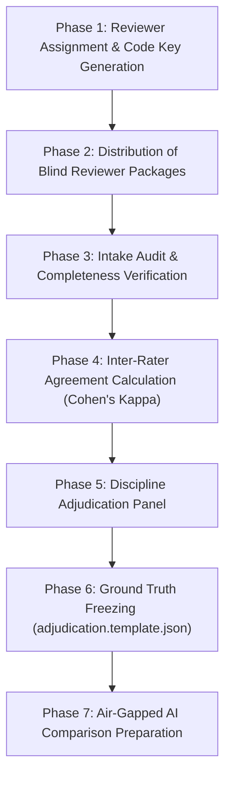

# RESEARCH COORDINATOR WORKFLOW GUIDE
**LCUP Syllabus Management System — Academic Validation Pilot**  
**Standard Operating Procedures for Evaluation Administration, Quality Audit, Adjudication, and Ground Truth Freezing**

---

## 1. ROLE & CORE RESPONSIBILITIES

The Research Coordinator serves as the administrative custodian of the academic validation pilot. The Coordinator is responsible for:
- Maintaining AI-blinding and reviewer anonymization safeguards.
- Assigning reviewer codes and safeguarding the identity key.
- Conducting intake quality audits on submitted evaluation workbooks.
- Calculating inter-rater agreement (Cohen's Kappa).
- Facilitating discipline adjudication panels.
- Freezing authoritative faculty reference ground truth in benchmark JSON structures.
- Managing air-gapped comparison data preparation.

> [!IMPORTANT]
> **Prohibition of Automated Contact**: Faculty reviewers must be contacted and appointed strictly through institutional academic channels (Deans and Department Chairs). Automated email scripts or programmatic notifications are strictly prohibited.

---

## 2. STEP-BY-STEP OPERATIONAL WORKFLOW

---

## 3. DETAILED OPERATIONAL PROCEDURES

### Phase 1: Reviewer Assignment & Anonymization Key
1. Coordinate with College Deans to confirm appointments of two qualified faculty evaluators per course:
   - **IT 202**: Reviewers `R-IT-01` and `R-IT-02` (Adjudicator: `ADJ-IT-01`)
   - **IE 402**: Reviewers `R-IE-01` and `R-IE-02` (Adjudicator: `ADJ-IE-01`)
   - **CPE 304**: Reviewers `R-CPE-01` and `R-CPE-02` (Adjudicator: `ADJ-CPE-01`)
2. Confirm that appointed reviewers are **not** the authors of the target syllabi.
3. Generate the confidential **Reviewer Anonymization Master Key** mapping codes to faculty names.
4. Store the master key in coordinator-restricted storage; never share it with reviewers or include it in evaluation folders.

### Phase 2: Package Distribution
1. From `docs/lcup-faculty-validation-1/for-reviewers/`, distribute strictly the designated materials to each reviewer:
   - IT Evaluators: `case-booklet.html` + `academic-evaluation-rubric.md` + `faculty-evaluation-form-IT202.xlsx`
   - IE Evaluators: `case-booklet.html` + `academic-evaluation-rubric.md` + `faculty-evaluation-form-IE402.xlsx`
   - CpE Evaluators: `case-booklet.html` + `academic-evaluation-rubric.md` + `faculty-evaluation-form-CpE304.xlsx`
   - Instructions: `docs/verification/faculty-reviewer-instructions.md`
2. **Confidentiality Check**: Confirm that **no coordinator-only files** (`validation-dataset.json`, `selection-record.*`, `faculty-claude-comparison-template.xlsx`, `missing-mappings-and-non-evaluable.md`) are distributed to reviewers.

### Phase 3: Intake & Completeness Audit
Upon receipt of completed evaluation workbooks, the Coordinator executes a line-by-line quality audit:
1. **Judgment Verification**: Every assigned case row must contain an explicit judgment from the dropdown (`ALIGNED`, `PARTIALLY_ALIGNED`, `NOT_ALIGNED`, `INSUFFICIENT_EVIDENCE`).
2. **Quotation Audit**: The academic justification must contain exact quoted phrases from both compared statements inside quotation marks (`"..."`).
3. **Correction Check**: If the verdict is `PARTIALLY_ALIGNED` or `NOT_ALIGNED`, a constructive recommended correction must be present.
4. **Metadata Check**: Reviewer ID must match the assigned code.
5. **Handling Incomplete Workbooks**: If an omission is discovered, the workbook is returned to the evaluator **solely to complete the missing fields**. The Coordinator must never suggest, influence, or alter a judgment.

### Phase 4: Inter-Rater Agreement Measurement
1. Open `docs/lcup-faculty-validation-1/coordinator-only/faculty-claude-comparison-template.xlsx`.
2. Enter Reviewer 1 judgments in Column F and Reviewer 2 judgments in Column H.
3. The Summary worksheet computes:
   - **Observed Agreement ($P_o$)**: Percentage of cases where both reviewers selected the identical judgment.
   - **Cohen's Kappa ($\kappa$)**: Chance-corrected consensus index.
4. Record concordance per course discipline. Note: With 7 to 9 cases per subject, Cohen's Kappa is descriptive and must be accompanied by raw percentage agreement and qualitative analysis.

### Phase 5: Documented Discipline Adjudication
1. Convene the designated Discipline Adjudicator (Department Chair or Senior Academic Lead) for each subject.
2. The Adjudicator reviews:
   - Cases with unanimous reviewer agreement (to confirm academic validity).
   - Cases with split reviewer judgments (to resolve divergence).
3. The Adjudicator reads both written justifications and syllabus evidence, recording a single authoritative **Faculty Reference Judgment**.
4. **Strict Rules**:
   - Automated averaging or coin-toss tie-breaking is strictly prohibited.
   - If a case remains academically irreconcilable due to an unaddressed institutional ambiguity, it is flagged as `AMBIGUOUS / PENDING INSTITUTIONAL POLICY`.

### Phase 6: Freezing Faculty Reference Ground Truth
1. Open `docs/lcup-faculty-validation-1/coordinator-only/adjudication.template.json`.
2. Populate the adjudicated consensus judgment, summary rationale, and approved correction for each case ID (`FV-01` to `FV-21`).
3. Save the populated file as `coordinator-only/adjudication.json`.
4. Compute and record its SHA-256 hash. Once frozen, the faculty reference becomes immutable and cannot be modified based on subsequent AI results.

### Phase 7: Air-Gapped AI Comparison Preparation
1. Confirm that VPAA Decision 14b (External AI Transmission) has been formally granted in writing.
2. Ingest the frozen benchmark case pairs into the authorized Policy V2 testing adapter.
3. Populate `coordinator-only/model-results.template.json` with actual Claude model outputs (verdict, explanation, proposed rewrite).
4. Run the comparison analysis script (`node scripts/lcup-faculty-validation/measure.cjs`) to generate the official confusion matrix, F1 metrics, and concordance tables.

---

## 4. PROVENANCE & AUDIT TRAIL LOGGING

The Coordinator must maintain an immutable **Validation Provenance Log** recording:
- Date, time, and file hash of distributed reviewer packages.
- Timestamps of returned reviewer workbooks.
- Reviewer calibration attendance records.
- Signed adjudication session minutes.
- Cryptographic SHA-256 hashes of all raw and processed evaluation artifacts.
