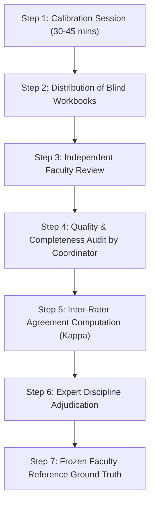

# FACULTY ACADEMIC VALIDATION PROTOCOL
**LCUP Syllabus Management System — Hybrid AI Checker**  
**Academic Relationship Validation Pilot (Package: `lcup-faculty-validation-1`)**

---

## 1. OBJECTIVES & OVERVIEW

The primary objective of this academic validation pilot is to establish an authoritative, human-expert faculty reference for evaluating the seven academic relationships defined by the Office of the Vice President for Academic Affairs (VPAA).

The evaluation is conducted on a balanced sample of **21 academic relationship cases** drawn from three verified institutional syllabi:
- **BSIT**: IT 202 — *Computer Programming 1* (7 cases)
- **BSIE**: IE 402 — *Systems Engineering* (9 cases)
- **BSCpE**: CPE 304 — *Fundamentals of Mixed Signals and Sensors* (5 cases)

Each case represents one isolated pairing between syllabus elements (for example, weekly course content and its intended learning outcome, or an ILO and its mapped course learning outcome). Reviewers evaluate these relationships independently, using established academic standards and institutional context, without exposure to AI-generated answers.

---

## 2. AI-BLINDED INDEPENDENT EVALUATION & INTEGRITY SAFEGUARDS

To prevent confirmation bias, cognitive anchoring, or halo effects, the validation protocol enforces strict AI-blinded independent evaluation safeguards:

1. **Zero Exposure to AI Judgments**: Faculty reviewers are provided strictly with the syllabus evidence, the case booklet, and the rubric. No AI-generated verdicts, model explanations, or automated recommendations are included in the reviewer materials.
2. **Zero Ground-Truth Anchoring**: The validation cases contain no "expected" or "model" answers. Reviewers judge each relationship solely on its academic merits.
3. **No Author Self-Review**: Syllabi are evaluated by discipline-qualified faculty members who are **not** the authors of the syllabi under review.
4. **Anonymized Reviewer Codes**: Reviewers record responses under an assigned identifier (e.g., `R-IT-01`, `R-IE-02`) rather than personal names, protecting evaluator privacy during adjudication.
5. **Data Minimization**: Reviewers receive only the necessary curricular text (course title, description, CLOs, lesson outlines, and the specific weekly rows under examination). Personal contact details, instructor signatures, core values column, and grading breakdowns are excluded.

---

## 3. REVIEWER RESPONSIBILITIES & QUALIFICATIONS

### Reviewer Profile
- **Discipline Competence**: Reviewers must hold academic qualifications in the discipline of the course they evaluate (Information Technology, Industrial Engineering, or Computer Engineering).
- **Curricular Familiarity**: Basic familiarity with outcome-based education (OBE) and CHED/institutional syllabus frameworks.
- **Independence**: Reviewers must not have participated in drafting the specific syllabus version under evaluation.

### Core Duties
1. Attend a 30-to-45-minute orientation and calibration session before starting.
2. Review assigned cases independently without consulting other faculty members, the syllabus authors, or AI tools.
3. Record a discrete judgment, an evidence-based justification quoting both statements, and an optional suggested correction for each case.
4. Return the completed workbook directly to the Research Coordinator.

---

## 4. THE FOUR DISCRETE ACADEMIC JUDGMENTS

Reviewers must select exactly one of the four institutional judgments for each case:

| Judgment | Operational Definition | Review Criteria |
| :--- | :--- | :--- |
| **`ALIGNED`** | The supplied evidence fully supports this academic relationship. | The content, scope, and cognitive level of both statements are mutually coherent; no material gap or pedagogical conflict exists. |
| **`PARTIALLY_ALIGNED`** | There is meaningful alignment, but a material gap, ambiguity, or scope mismatch remains. | Elements overlap, but one statement omits critical competencies, reaches beyond the week's scope, or introduces pedagogical ambiguity that would impact instructional delivery. |
| **`NOT_ALIGNED`** | There is a substantiated contradiction, disconnect, or mismatch. | The two statements concern unrelated subject matter, mismatched technical domains, or mutually incompatible objectives. |
| **`INSUFFICIENT_EVIDENCE`** | The supplied text cannot support a defensible judgment. | One or both statements are excessively brief, circular, or worded in purely generic terms (e.g., "Lecture using PowerPoint", "Quiz on topics discussed") without substantive academic details. |

---

## 5. CLO CLASSIFICATION RIGOR

In the LCUP syllabus framework, Course Learning Outcomes follow a fixed classification structure tied to their numerical sequence:
- **CLO 1**: `Introductory`
- **CLO 2**: `Enabling`
- **CLO 3**: `Demonstrating`
- **CLO 4**: `Integration of Values`

### Evaluation Principle
When evaluating **ILO $\leftrightarrow$ CLO** mappings (cases FV-04, FV-12, FV-17), reviewers must evaluate whether the mapped ILO genuinely builds toward the CLO statement and its designated developmental level.

> [!IMPORTANT]
> **Beyond Bloom's Verbs**: Alignment must not be determined by verb matching alone. Reviewers must assess:
> - The technical scope and context of the ILO.
> - The actual developmental depth expected by the CLO statement.
> - The cumulative progression across preceding and succeeding weeks.
> - The institutional distinction between enabling competencies and demonstrative mastery.

---

## 6. CALIBRATION & STEP-BY-STEP EVALUATION PROCEDURE

### Step 1: Calibration (Prior to Independent Review)
- The Research Coordinator convenes reviewers for a walkthrough of the rubric and sample fictional cases.
- **Rule of Isolation**: The 21 actual validation cases are **never discussed** during calibration.

### Step 2: Distribution
Reviewers receive self-contained packages:
- **IT Reviewers**: `for-reviewers/faculty-evaluation-form-IT202.xlsx` + `case-booklet.html`
- **IE Reviewers**: `for-reviewers/faculty-evaluation-form-IE402.xlsx` + `case-booklet.html`
- **CpE Reviewers**: `for-reviewers/faculty-evaluation-form-CpE304.xlsx` + `case-booklet.html`
- Universal Rubric: `for-reviewers/academic-evaluation-rubric.md`

### Step 3: Independent Review Execution
For every case row, the reviewer completes:
1. **Faculty Judgment**: Select from `ALIGNED`, `PARTIALLY_ALIGNED`, `NOT_ALIGNED`, or `INSUFFICIENT_EVIDENCE`.
2. **Academic Justification**: 1 to 3 sentences explaining the verdict. **Mandatory**: Must quote exact key phrases from both compared statements within quotation marks.
3. **Recommended Correction**: Required if judgment is `PARTIALLY_ALIGNED` or `NOT_ALIGNED`. Proposes constructive replacement text. Enter `"None"` if aligned.
4. **Reviewer ID**: Assigned code (e.g., `R-IT-01`).
5. **Within Expertise? (Optional)**: Flag `"Yes"`, `"No"`, or `"Uncertain"`.
6. **Requires Institutional Decision? (Optional)**: Flag `"Yes"` if judgment hinges on an undefined institutional policy (e.g., values-formation integration rules).
7. **Notes (Optional)**: Notes on formatting, transcription, or structural observations.

### Step 4: Completeness Audit
The Coordinator verifies that returned forms contain no empty verdict cells, that quotations are present in justifications, and that corrections are supplied where required. Forms with omissions are returned solely for completion, never to influence or alter a judgment.

### Step 5: Inter-Rater Agreement Calculation
For each course, independent reviewer pairs (Slot 1 vs. Slot 2) are compared to measure observed percentage agreement and Cohen's Kappa ($\kappa$).

### Step 6: Discipline Adjudication
A designated Discipline Lead or Senior Academic Adjudicator reviews the independent evaluations and justifications to establish a single, authoritative **Faculty Reference Judgment** for each of the 21 cases. Averaging or automated majority voting is prohibited.

---

## 7. DATA PROTECTION, RETENTION & ETHICAL GOVERNANCE

1. **Local Confinement**: All validation materials, reviewer workbooks, and adjudication records must remain strictly on institutional university storage. Uploading to public cloud drives, online spreadsheet services, or third-party web tools is prohibited.
2. **Confidentiality of Identity**: The key linking reviewer names to reviewer codes (`R-xx-yy`) is stored separately in coordinator-restricted storage.
3. **Intellectual Property**: Syllabus text remains the academic property of LCUP and its faculty authors. Excerpts are used strictly for internal institutional quality verification.
4. **Prohibition of Automated Faculty Contact**: Evaluators are invited through formal institutional academic channels by department heads, never via automated bot or script dispatches.
