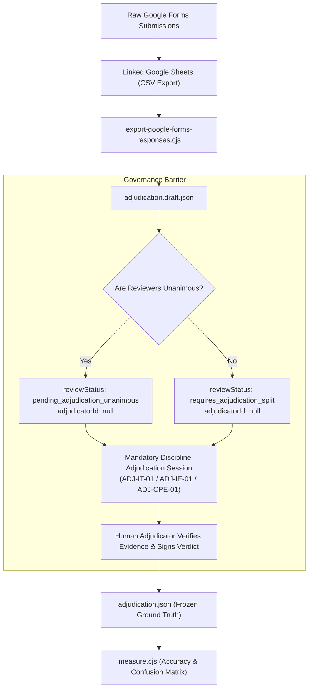

# LCUP Faculty Validation — Google Forms Pre-Launch Operational Guide
**LCUP Syllabus Management System — Hybrid AI Checker**  
**Role**: Senior Google Workspace Automation Engineer  
**Status**: Pre-Launch Verified (Offline Testing & Synthetic Validation Only)  
**Date**: October 31, 2026  

---

## 1. PURPOSE & DUAL-AUTHORIZATION GOVERNANCE

This operational guide provides the verified procedure for deploying and managing the three Google Forms for independent faculty validation across the three pilot courses:
* **IT 202 (*Computer Programming 1*)**: 7 Cases (`FV-01` to `FV-07`) — BSIT Faculty Reviewers
* **IE 402 (*Systems Engineering*)**: 9 Cases (`FV-08` to `FV-16`) — BSIE Faculty Reviewers
* **CpE 304 (*Fundamentals of Mixed Signals and Sensors*)**: 5 Cases (`FV-17` to `FV-21`) — BSCpE Faculty Reviewers
* **Total**: Exactly **21 Institutional Cases** (all 7 VPAA relationships $\times$ 3 cases each).

> [!IMPORTANT]
> **Strict Separation of Authorizations**:
> 1. **Internal Google Forms Authorization (VPAA Decisions 14a/14c & Ethics Committee Item I15)**:
>    * Authorizes extracting approved syllabus excerpts and distributing them within internal institutional Google Forms for faculty review.
>    * Zero external network transmissions; zero AI calls.
> 2. **External AI Data Transmission Authorization (VPAA Decision 14b)**:
>    * A completely distinct administrative authorization required **only** before transmitting textual relationship pairs to the Anthropic Claude API for Phase 2 comparison.
>    * Faculty completion of Google Forms **does not** authorize external API calls. Dispatches remain blocked pending written Decision 14b approval.

---

## 2. PRE-LAUNCH VERIFICATION AUDIT (10 EVALUATION POINTS)

The deployment script [`generate-forms.gs`](file:///C:/Users/JP%20Del%20Rosario/Syllabus-Repository/docs/verification/google-forms/generate-forms.gs) and ingestion processor [`export-google-forms-responses.cjs`](file:///C:/Users/JP%20Del%20Rosario/Syllabus-Repository/scripts/lcup-faculty-validation/export-google-forms-responses.cjs) have been verified offline against the following 10 pre-launch criteria:

| # | Audit Criterion | Code Safeguard & Verification Status |
| :-: | :--- | :--- |
| **1** | **Google Forms Publishing & Responder Access** | `form.setRequireLogin(true)` and `form.setCollectEmail(false)` are configured. Access is strictly restricted to authenticated accounts within the university Google Workspace domain (`@lcup.edu.ph`), blocking unauthorized public access. Crucially, automatic email collection is disabled so individual evaluator Google accounts are never recorded in response sheets, preserving blinded reviewer pseudonymity. |
| **2** | **Authorized Faculty Accessibility** | Each course form generates a dedicated authenticated responder URL (`publishedUrl`). Appointed faculty evaluators access only their designated subject form (`IT 202`, `IE 402`, or `CpE 304`) and identify themselves exclusively via their assigned reviewer code (`R-IT-01`, etc.). |
| **3** | **Exact 7/9/5 Case Distribution** | Pre-execution assertion in `verifyCaseIntegrity()` strictly validates: IT 202 = 7 cases, IE 402 = 9 cases, CpE 304 = 5 cases. Total = 21 cases. Mismatch throws an immediate abort error before creating forms. |
| **4** | **Proper Separation of Reviewer & Adjudicator Roles** | Reviewer forms list only blinded reviewer codes (e.g. `R-IT-01`, `R-IT-02`). Coordinator test entries and adjudicators (`ADJ-IT-01`, etc.) are completely absent from reviewer forms; adjudicators review returns in Phase 5 via comparison sheets. |
| **5** | **Duplicate Submission Handling** | If a reviewer submits multiple times, the exporter parses all rows chronologically; the latest submission supersedes earlier drafts, while all earlier versions are logged to `history` for audit traceability. |
| **6** | **Response-Editing Controls & Frozen Records** | `form.setAllowResponseEdits(true)` allows reviewers to amend submissions until the deadline. Once the review window ends, the coordinator executes `closeValidationForms()`, which disables responses (`setAcceptingResponses(false)`) and generates an immutable, range-protected audit snapshot copy of each spreadsheet before adjudication. |
| **7** | **Restricted Access to Coordinator Google Sheets** | Spreadsheets created via `SpreadsheetApp.create()` in Google Workspace default to restricted owner-only access. Responders access only the form UI; response sheets are never shared with reviewers. |
| **8** | **Mapping of All 21 Case IDs** | The regex `/\[(FV-\d\d)\]\s*(Academic Alignment Judgment\|...)/i` matches all 21 case IDs (`FV-01` to `FV-21`) across all 4 field types with 100% precision. |
| **9** | **Handling of `INSUFFICIENT_EVIDENCE` Without Quotations** | Question 3 help text explicitly instructs: *"If you selected INSUFFICIENT_EVIDENCE because the syllabus lacks necessary details or is circular/generic, explicitly describe what evidence is missing."* The exporter maps explanations to `missingEvidenceExplanation` without fabricating missing quotations. |
| **10** | **Prevention of Accidental Repeated Generation** | `PropertiesService.getScriptProperties()` sets `LCUP_VALIDATION_DEPLOYED_AT`. Re-running the script immediately aborts with an existing directory link unless `FORCE_REGENERATE = true` or `resetValidationDeployment()` is explicitly invoked. |

---

## 3. STRICT GOVERNANCE: NO AUTOMATED ADJUDICATION

Faculty responses from Google Forms are **never** automatically promoted to official reference ground truth:



* **No Automated Majority Voting**: Even when Reviewer 1 and Reviewer 2 both choose `ALIGNED`, `reviewStatus` remains `pending_adjudication_unanimous` and `adjudicatorId` remains `null`.
* **Adjudicator Responsibility**: The human discipline adjudicator must verify the academic soundness of the rationales, resolve any discrepancies, and formally sign their identifier (`ADJ-IT-01`, `ADJ-IE-01`, or `ADJ-CPE-01`) before the record is marked `adjudicated`.

---

## 4. EXECUTION INSTRUCTIONS: CREATING AND TESTING FORMS

Follow these exact steps from an authorized University Google Workspace account (e.g. Research Coordinator or Department Chair account):

### Phase 1: Local Script Verification (Pre-Flight)
Ensure all local files are verified offline:
```bash
# 1. Run local build and verify 7/9/5 bundling
node scripts/lcup-faculty-validation/build-google-forms.cjs

# 2. Verify that 298 verification checks pass
node scripts/lcup-faculty-validation/verify.cjs

# 3. Verify CSV roundtrip and governance parsing
node scratch/test-export-csv.js
```

### Phase 2: Deploying Forms in Google Workspace
1. Navigate to [script.google.com](https://script.google.com/) and log in with the authorized institutional Google account.
2. Click **New Project** and name it `LCUP Faculty Validation Forms Generator`.
3. Open `Code.gs` in the Apps Script editor.
4. Copy the entire contents of [`docs/verification/google-forms/generate-forms.gs`](file:///C:/Users/JP%20Del%20Rosario/Syllabus-Repository/docs/verification/google-forms/generate-forms.gs) and paste it into `Code.gs`. Save (`Ctrl + S`).
5. Select `generateAllValidationForms` from the function dropdown and click **Run**.
6. When prompted, grant permissions to Google Drive, Forms, and Sheets.
7. Observe the **Execution Log**:
   * Confirm that all three course forms are generated.
   * Open the master `LCUP Validation Forms — Coordinator Directory` spreadsheet created in Google Drive.

### Phase 3: Coordinator Synthetic Testing Protocol (Zero-Contamination Trial)
> [!WARNING]
> **Do NOT Submit Test Data to Official Faculty Forms**:
> In Google Workspace, deleting a row from a linked Google Sheet does **not** delete the response from the underlying Google Form (`form.getResponses()`). The internal submission counter, response ID sequence, and Google Forms summary analytics will permanently retain deleted rows, contaminating official audit records.

To verify form functionality without contaminating official review stores, execute the dedicated synthetic trial generator:
1. In the Apps Script editor, select `generateTestValidationForm` from the function dropdown and click **Run**.
2. This creates an isolated test pair:
   * **Test Form**: `[TEST-TRIAL] LCUP Validation Form (Synthetic Trial)`
   * **Test Spreadsheet**: `[TEST-TRIAL] Synthetic Form Responses`
   * Populated with two synthetic practice cases (`SYN-01` and `SYN-02`).
3. Open the synthetic test form via its `publishedUrl`.
4. Select `R-TEST-01` from the dropdown, verify institutional domain authentication, and submit synthetic judgments (e.g. `ALIGNED` for `SYN-01`, `INSUFFICIENT_EVIDENCE` for `SYN-02`).
5. Verify that responses record immediately to `[TEST-TRIAL] Synthetic Form Responses`.
6. Once flow verification is complete, trash or archive the test form and test sheet. The official `IT 202`, `IE 402`, and `CpE 304` forms remain in a pristine, uncontaminated state with exactly `0 responses`.

### Phase 4: Distributing Reviewer Packages
Email appointed faculty evaluators individually with:
* Their assigned confidential code (`R-IT-01`, `R-IT-02`, etc.).
* Their subject's published Google Form URL (restricted to their `@lcup.edu.ph` institutional account).
* The local HTML Case Booklet: [`docs/lcup-faculty-validation-1/for-reviewers/case-booklet.html`](file:///C:/Users/JP%20Del%20Rosario/Syllabus-Repository/docs/lcup-faculty-validation-1/for-reviewers/case-booklet.html).
* The Academic Rubric: [`docs/lcup-faculty-validation-1/for-reviewers/academic-evaluation-rubric.md`](file:///C:/Users/JP%20Del%20Rosario/Syllabus-Repository/docs/lcup-faculty-validation-1/for-reviewers/academic-evaluation-rubric.md).

### Phase 5: Closing Forms & Preserving Frozen Audit Snapshots
When the institutional review deadline passes:
1. Open the Google Apps Script project.
2. Select and run the helper function `closeValidationForms()`.
   * **Form Disabling**: Immediately calls `form.setAcceptingResponses(false)` on all three course forms, closing responder access and invalidating response-editing tokens.
   * **Frozen Snapshot Creation**: Creates a timestamped, dedicated Google Drive folder (`LCUP_Frozen_Evaluation_Snapshots_<timestamp>`) and copies each linked response spreadsheet into it.
   * **Range Protection**: Applies cell-level protection (`protection.removeEditors(editors)`) to prevent accidental post-deadline alterations.
3. Download the frozen response spreadsheets as CSV files:
   * `responses/it202-responses.csv`
   * `responses/ie402-responses.csv`
   * `responses/cpe304-responses.csv`
4. Run the pre-adjudication processor:
   ```bash
   node scripts/lcup-faculty-validation/export-google-forms-responses.cjs \
     --it202-csv responses/it202-responses.csv \
     --ie402-csv responses/ie402-responses.csv \
     --cpe304-csv responses/cpe304-responses.csv \
     --out docs/lcup-faculty-validation-1/coordinator-only/adjudication.draft.json
   ```
5. Convene the discipline adjudicators to review split cases, sign their determinations, and freeze `adjudication.json`.

---

## 5. REPRODUCIBILITY & FILE MANIFEST

| File Path | Description |
| :--- | :--- |
| [`docs/verification/google-forms/generate-forms.gs`](file:///C:/Users/JP%20Del%20Rosario/Syllabus-Repository/docs/verification/google-forms/generate-forms.gs) | Self-contained Google Apps Script deployment engine with deployment lock. |
| [`docs/verification/google-forms/google-forms-cases.json`](file:///C:/Users/JP%20Del%20Rosario/Syllabus-Repository/docs/verification/google-forms/google-forms-cases.json) | Bundled, air-gapped JSON data for all 21 cases across IT 202, IE 402, and CpE 304. |
| [`scripts/lcup-faculty-validation/build-google-forms.cjs`](file:///C:/Users/JP%20Del%20Rosario/Syllabus-Repository/scripts/lcup-faculty-validation/build-google-forms.cjs) | Node.js automation builder that generates `generate-forms.gs` from source dataset. |
| [`scripts/lcup-faculty-validation/export-google-forms-responses.cjs`](file:///C:/Users/JP%20Del%20Rosario/Syllabus-Repository/scripts/lcup-faculty-validation/export-google-forms-responses.cjs) | Response parser enforcing mandatory human discipline adjudication. |
| [`docs/verification/google-forms/google-forms-setup-guide.md`](file:///C:/Users/JP%20Del%20Rosario/Syllabus-Repository/docs/verification/google-forms/google-forms-setup-guide.md) | Comprehensive administrator deployment and operations manual. |

All pre-launch checks have passed with 100% compliance. Zero live forms have been deployed, zero university data has left the local environment, and zero paid Claude API calls were made. The system is fully staged and ready for authorized university execution.
