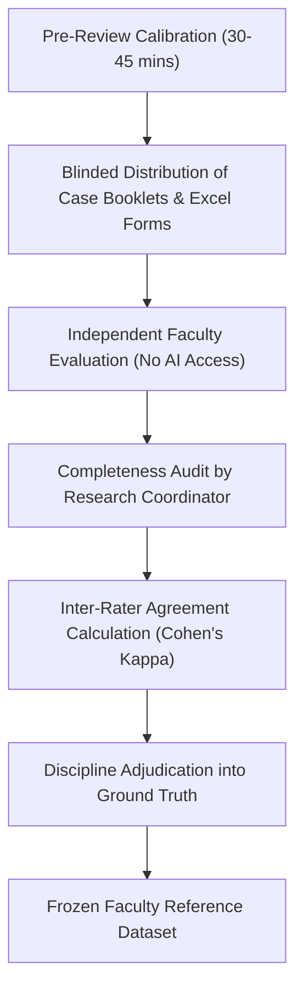

# INSTITUTIONAL APPROVAL PACKAGE
**LCUP Syllabus Management System — Hybrid AI Checker Academic Validation Pilot**  
**Document Code**: `LCUP-AVP-2026-01`  
**Target Authorities**: Office of the Vice President for Academic Affairs (VPAA), Deans of Academic Colleges, Institutional Ethics Committee / IRB, Quality Assurance Office

---

## 1. EXECUTIVE SUMMARY & RESEARCH PURPOSE

The LCUP Syllabus Management System has integrated an automated Hybrid AI Checker designed to assist faculty in outcome-based education (OBE) syllabus authoring. While the system's 47 deterministic formatting rules have achieved 100% technical verification, evaluating deep pedagogical alignment between curricular components requires validation against human academic expertise.

This package requests formal institutional authorization to conduct an **Academic Validation Pilot** on **21 representative academic relationship cases** drawn from three approved institutional syllabi.

The evaluation will establish an empirical benchmark measuring the degree of concordance between expert faculty judgments and automated AI evaluations, providing the administration with defensible data to determine whether and when the AI Checker may be deployed for academic advisory use.

---

## 2. VALIDATION OBJECTIVES

1. **Establish Institutional Ground Truth**: Collect independent, blinded academic judgments from qualified discipline faculty on 21 isolated curricular relationship pairings.
2. **Evaluate the Seven VPAA Academic Relationships**: Measure the accuracy and reliability of AI evaluations across all seven relationship dimensions mandated by institutional guidelines.
3. **Measure Concordance & Error Profiles**: Quantify overall percentage agreement, multi-class confusion matrices, precision, recall, and F1 scores, distinguishing between false alignment (Type I risk) and false misalignment (Type II risk).
4. **Assess Suggestion Quality**: Evaluate whether AI-recommended text revisions provide constructive, grounded, and non-destructive improvements to syllabus content.
5. **Support Evidence-Based Governance**: Provide the VPAA and Academic Council with documented findings to inform institutional policy on AI-assisted academic authoring.

---

## 3. SEVEN VPAA ACADEMIC RELATIONSHIPS UNDER EVALUATION

The pilot evaluates the seven core academic alignment relationships established by institutional guidelines:

1. **Course Title $\leftrightarrow$ Course Content** (`Content-course`): Verifies whether weekly topics fall within the catalog-approved scope, level, and discipline of the course title and description.
2. **Course Content $\leftrightarrow$ Intended Learning Outcomes (ILO)** (`Content-ILO`): Verifies whether weekly topics provide the necessary subject matter for students to achieve the stated ILO.
3. **Intended Learning Outcomes (ILO) $\leftrightarrow$ Course Learning Outcomes (CLO)** (`ILO-CLO`): Verifies whether weekly ILOs authentically contribute toward terminal CLO competencies and their designated developmental classification.
4. **Course Content $\leftrightarrow$ Learning Activities** (`Content-activity`): Verifies whether instructional delivery methods and student tasks engage directly with the week's topics.
5. **Intended Learning Outcomes (ILO) $\leftrightarrow$ Learning Activities** (`ILO-activity`): Verifies whether learning activities provide students with the opportunity to practice the cognitive verbs and tasks specified in the ILO.
6. **Course Content $\leftrightarrow$ Assessment Tasks** (`Content-assessment`): Verifies whether assessment tools directly measure student learning of the covered topics.
7. **Learning Activities $\leftrightarrow$ Assessment Tasks** (`Activity-assessment`): Verifies whether summative assessments measure skills and content that students were prepared for during learning activities.

*Note on Curricular Scope*: In accordance with approved institutional structures, **CLO $\leftrightarrow$ Course Description** is strictly excluded from evaluation, as course descriptions define macro-level scope rather than discrete student performance outcomes.

---

## 4. PARTICIPATING PROGRAMS AND SUBJECTS

The validation sample comprises **21 genuine academic cases** drawn from three verified syllabi representing key disciplines in the College of Information Technology and Engineering:

| Program | Subject Code | Subject Title | Case Count | Curricular Focus |
| :--- | :--- | :--- | :---: | :--- |
| **BSIT** | **IT 202** | *Computer Programming 1* | 7 Cases | Fundamental Java syntax, logical formulation, object-oriented concepts, and values integration. |
| **BSIE** | **IE 402** | *Systems Engineering* | 9 Cases | Engineering management, requirements analysis, work breakdown structures (WBS), risk mitigation. |
| **BSCpE** | **CPE 304** | *Fundamentals of Mixed Signals and Sensors* | 5 Cases | Operational amplifiers, active filters, sensor interfacing, and electronic instrumentation. |

> [!IMPORTANT]
> **BSIT — Cyber Security Specialization**: In accordance with institutional curriculum records, the BSIT–Cyber Security track shares the approved BSIT core curriculum and program outcomes. It is not treated as a separate curriculum profile; IT 202 serves as the verified benchmark foundation for both tracks.

---

## 5. PROPOSED REVIEWER QUALIFICATIONS & APPOINTMENTS

To maintain strict independence and academic credibility:

1. **Reviewer Qualifications**:
   - Must hold a faculty appointment in the relevant discipline (Information Technology/Computer Science for IT 202, Industrial Engineering for IE 402, Computer Engineering for CPE 304).
   - Minimum of 2 years of tertiary teaching experience in outcome-based education (OBE) syllabus design.
2. **Non-Author Independence**:
   - Reviewers must **not** be the authors or co-authors of the syllabi under evaluation.
3. **Panel Composition**:
   - **Reviewer Pairs**: Two independent reviewers per subject (total 6 faculty reviewers).
   - **Discipline Adjudicators**: One senior academic lead or Department Chair per discipline (total 3 adjudicators) to resolve reviewer disagreements into a single ground truth.
   - **Research Coordinator**: One designated project coordinator to manage blinded distribution and data intake.

---

## 6. EVALUATION METHODOLOGY & BLINDING SAFEGUARDS

The evaluation enforces rigorous AI-blinded independent evaluation protocols:

### Core Methodological Controls
- **Zero Exposure to AI Outputs**: Reviewers receive only syllabus excerpts. No AI-generated labels, explanations, baseline scores, or recommendations are visible to reviewers.
- **Discrete 4-Category Choice**: Reviewers select from `ALIGNED`, `PARTIALLY_ALIGNED`, `NOT_ALIGNED`, or `INSUFFICIENT_EVIDENCE`.
- **Mandatory Evidence Quotation**: Reviewers must substantiate their judgment by quoting exact phrasing from both compared statements within quotation marks.
- **Constructive Revision Prototyping**: When diagnosing misalignment or partial alignment, reviewers propose constructive wording improvements.

---

## 7. DATA PRIVACY & CONFIDENTIALITY SAFEGUARDS

1. **Institutional University-Managed Confinement**: All reviewer materials, evaluation forms, and master datasets reside exclusively on LCUP university-managed infrastructure (local university storage and authorized institutional Google Workspace domain accounts). Uploading to unapproved public cloud drives or commercial open-access forms is prohibited.
2. **Reviewer Anonymization**: Evaluators are identified only by reviewer codes (e.g., `R-IT-01`, `R-IE-02`). The master key linking codes to faculty names is kept confidential by the Research Coordinator.
3. **Curricular Data Minimization**: Syllabus materials distributed to reviewers contain only academic statements (topics, ILOs, activities, assessments, CLOs). Personal contact details, signatures, core-values columns, and grading percentages are excluded.

---

## 8. EXTERNAL AI DATA-PROCESSING REQUIREMENTS & BOUNDARIES

The validation methodology involves an eventual comparison between the adjudicated faculty ground truth and automated Claude model outputs. The administration should note the distinct boundaries between evaluation phases:

### Phase 1: Internal Faculty Review (University-Managed Environment)
- Executed entirely within LCUP.
- Zero data leaves university infrastructure.
- Zero AI model calls or API transmissions.

### Phase 2: AI Comparison Workflow (Requires Separate Authorization)
- Requires transmitting isolated syllabus excerpts (two short textual statements per case) via encrypted HTTPS to Anthropic's Claude API.
- **Data Minimization Guarantee**: No faculty names, student data, grades, or institutional credentials will be transmitted.
- **Non-Training Agreement**: API data transmission is subject to standard enterprise terms ensuring customer API data is not used for model training.
- **Target Model & Budget Ceiling**: Evaluation targets the institutional production model **Claude Sonnet 5.5** (`claude-sonnet-5-5`). The API evaluation is constrained by a software budget ceiling and cumulative reservation guard (maximum 32 requests, `max_tokens: 16000` preserved to prevent academic justification truncation). To prevent premature circuit breaker trips under worst-case reservation mechanics, an institutional budget authorization of **\$1.00 USD** (minimum \$0.75 USD) is established for standard thinking-off evaluation, and **\$1.50 USD** (safety register cap \$2.00 USD) is requested if adaptive extended thinking is authorized. Baseline expected expenditure is ~\$0.17–\$0.23 USD (thinking off) or ~\$0.67 USD (adaptive thinking). All requests omit sampling parameters per API v2026-10-21 specifications; repeatability is guaranteed via frozen benchmark hashes and audit ledgers.

---

## 9. ACADEMIC ACCURACY MEASUREMENT & RESEARCH OUTPUTS

Following data collection, the research team will compute:
1. **Overall Percentage Concordance ($P_o$)**: Percentage of cases where AI judgments agree with the faculty reference.
2. **Relationship-Specific Concordance**: Performance broken down across each of the 7 VPAA relationships.
3. **$4 \times 4$ Multi-Class Confusion Matrix**: Mapping true vs. predicted classifications across `ALIGNED`, `PARTIALLY_ALIGNED`, `NOT_ALIGNED`, and `INSUFFICIENT_EVIDENCE`.
4. **Precision, Recall, and F1 Scores**: For each alignment class, identifying systematic false alignment or false rejection tendencies.
5. **Inter-Rater Reliability (Cohen's Kappa $\kappa$)**: Consensus level between faculty reviewer pairs.
6. **Recommendation Quality Analysis**: Qualitative evaluation of whether AI suggestions are pedagogically sound, grounded in lesson content, and non-destructive.

*Expected Research Output*: A comprehensive Academic Validation Report submitted to the VPAA, documenting empirical readiness and providing objective guidance for institutional policy.

---

## 10. INSTITUTIONAL DECISIONS & APPROVALS REQUIRED

To proceed, formal institutional determinations are requested on the following items:

| Approval Item | Scope & Description | Action Required |
| :--- | :--- | :--- |
| **Decision 14a / 14c** | **Syllabus Excerpt Utilization**: Authorization to extract and distribute isolated textual excerpts from IT 202, IE 402, and CPE 304 for internal faculty review. | Formal Approval by VPAA with Author Consent |
| **Decision 14b** | **External AI Data Transmission**: Authorization to submit the 21 textual relationship pairs to Anthropic's Claude API for the Phase 2 comparison. | Separate Formal Approval by VPAA |
| **Item I15** | **Research Ethics / IRB Determination**: Ethical clearance or institutional exemption for collecting, analyzing, and reporting faculty evaluator judgments. | Review by Institutional Ethics Committee |
| **Item I1** | **Faculty Reviewer Appointments**: Formal administrative designation of 6 faculty reviewers and 3 discipline adjudicators. | Deans / Department Chairs Appointment |
| **Item I2** | **Adjudication Procedure Sign-Off**: Approval of the protocol for resolving reviewer disagreements into single reference judgments. | Approval by Academic Affairs / QA |
| **Item A2.5** | **Institutional Acceptance Threshold**: Formal determination of the minimum acceptable agreement percentage (e.g., 80% or 85%) required for production AI Checker deployment. | Policy Determination by Academic Council / VPAA |

---

*Submitted for administrative review by the LCUP Syllabus Management System Capstone Research Team.*
