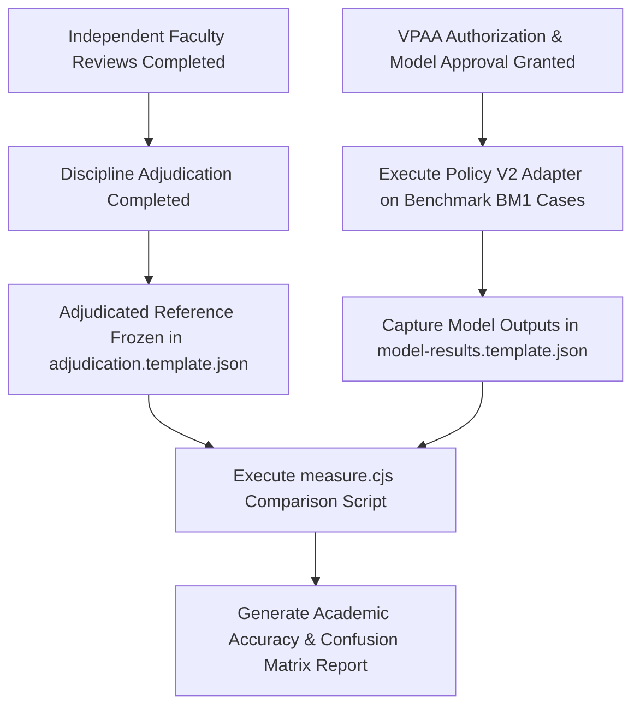

# STEP 7 — ACADEMIC VALIDATION PREPARATION REPORT
**LCUP Syllabus Management System — Hybrid AI Checker**  
**Preparation of Faculty Evaluation Framework, Blinding Protocol, and Academic Accuracy Measurement Methodology**

---

## 1. EXECUTIVE SUMMARY & PREPARATION STATUS

This report documents the completion of **Step 7 Preparation** for the academic validation of the LCUP Syllabus Management System Hybrid AI Checker. The objective of Step 7 is to design, package, and verify all necessary instrumentation, protocols, and measurement frameworks required to conduct an independent, expert-driven faculty validation of the seven VPAA academic relationships.

### Formal Verification Status Distinction

To maintain the highest standards of scientific and academic integrity, the project explicitly distinguishes between preparation, human execution, and institutional completion:

```
[✓] VALIDATION MATERIALS PREPARED   : COMPLETE (All forms, rubrics, booklets, datasets, and templates verified)
[ ] FACULTY EVALUATION COMPLETED    : PENDING (Awaiting formal faculty appointment and independent review)
[ ] AI COMPARISON COMPLETED         : PENDING (Awaiting adjudicated faculty reference and authorized API run)
[ ] ACADEMIC VALIDATION COMPLETED   : PENDING (Awaiting institutional review and VPAA sign-off)
```

> [!IMPORTANT]
> In strict compliance with research ethics and system boundaries, **no paid Claude API calls were executed**, **no faculty answers were simulated or fabricated**, **no institutional accuracy thresholds were invented**, and **Policy V2 remains disabled in production**. Step 7 is declared **prepared and verified for execution**, pending human administration.

---

## 2. INVENTORY & AUDIT OF EXISTING VALIDATION MATERIALS

An exhaustive audit of the repository identified two validation packages in `docs/`:

1. `docs/academic-validation-package/` (Historical Stage E.7 package): A mixed package containing synthetic test cases, historical Stage E.7 run outputs, and raw extracted text. Retained as historical project context.
2. `docs/lcup-faculty-validation-1/` (**Authoritative Step 7 Package**): The dedicated, version-locked faculty validation package built specifically for the seven VPAA academic relationships across verified institutional syllabi.

### Package Manifest & Integrity Audit (`docs/lcup-faculty-validation-1`)
The authoritative validation package was verified using the offline verification test harness (`scripts/lcup-faculty-validation/verify.cjs`). All **298 integrity checks passed with zero failures**:

| File Path | Audience | Origin | Purpose / Contents |
| :--- | :--- | :--- | :--- |
| `for-reviewers/case-booklet.html` | Faculty Reviewers | Generated | Self-contained, printable HTML booklet with course descriptions, CLOs, lesson outlines, and the 21 cases in weekly context. Contains **zero AI results or benchmark IDs**. |
| `for-reviewers/academic-evaluation-rubric.md` | Faculty Reviewers | Authored | Full evaluation rubric defining the four discrete judgments, criteria for all 7 VPAA relationships, Bloom's verb cautions, and CLO classification rules. |
| `for-reviewers/faculty-evaluation-form-IT202.xlsx` | IT Reviewers | Generated | Standalone Excel evaluation workbook containing the 7 IT 202 cases. Protected data cells; reviewer input in yellow cells. |
| `for-reviewers/faculty-evaluation-form-IE402.xlsx` | IE Reviewers | Generated | Standalone Excel evaluation workbook containing the 9 IE-402 cases. |
| `for-reviewers/faculty-evaluation-form-CpE304.xlsx` | CpE Reviewers | Generated | Standalone Excel evaluation workbook containing the 5 CpE 304 cases. |
| `for-reviewers/faculty-evaluation-form.xlsx` | Universal | Generated | Combined workbook containing all 21 cases for multi-disciplinary reviewers. |
| `coordinator-only/validation-dataset.json` | Coordinator | Generated | Complete JSON dataset binding each case (`FV-01` to `FV-21`) to frozen benchmark cases (`BM1-...`) and content hashes. |
| `coordinator-only/faculty-claude-comparison-template.xlsx` | Coordinator | Generated | Structured comparison workbook computing reviewer pair agreement, Cohen's Kappa, and faculty-versus-Claude comparison. |
| `coordinator-only/selection-record.md` & `.json` | Coordinator | Generated | Selection criteria, balance signals (e.g. apparent alignment / misalignment), and sampling rationale kept strictly confidential. |
| `coordinator-only/missing-mappings-and-non-evaluable.md` | Coordinator | Generated | Technical audit of untagged ILOs, missing assessment evidence, and held cases. |
| `coordinator-only/adjudication.template.json` | Coordinator | Generated | Benchmark JSON schema awaiting adjudicated consensus judgments. |
| `coordinator-only/model-results.template.json` | Coordinator | Generated | Benchmark JSON schema awaiting actual Claude model execution. |
| `institutional-definitions-and-evidence-gaps.md` | Research Team | Authored | Audit of open institutional policy items requiring VPAA/QA clarification. |
| `package-manifest.json` | Research Team | Generated | Cryptographic inventory recording SHA-256 hashes of all 14 package files. |
| `README.md` | Research Team | Authored | Package documentation, blinding rules, distribution steps, and administration protocol. |

---

## 3. AUDIT OF THE 21 VALIDATION CASES ACROSS VPAA RELATIONSHIPS

The validation dataset (`validation-dataset.json`) was audited to verify case counts, disciplinary coverage, and relationship representation:

### Distribution by Course & Discipline
- **BSIT — IT 202 (*Computer Programming 1*)**: **7 cases** (`FV-01` to `FV-07`)
- **BSIE — IE 402 (*Systems Engineering*)**: **9 cases** (`FV-08` to `FV-16`)
- **BSCpE — CPE 304 (*Fundamentals of Mixed Signals and Sensors*)**: **5 cases** (`FV-17` to `FV-21`)
- **Total Case Count**: **21 genuine institutional cases**

> [!IMPORTANT]
> **BSIT — Cyber Security Curriculum Alignment**: In accordance with institutional curriculum records, BSIT–Cyber Security inherits directly from the approved BSIT curriculum and program outcomes. It is not treated as a divergent curriculum profile; IT 202 represents the core computing foundation across both specializations.

### Distribution by VPAA Academic Relationship
Exactly **three cases** represent each of the seven VPAA academic relationships:

| Relationship Key | VPAA Academic Relationship | Represented Cases | Target Courses |
| :--- | :--- | :--- | :--- |
| `Content-course` | 1. Course Title $\leftrightarrow$ Course Content | `FV-06`, `FV-08`, `FV-10` | IT 202, IE-402 (2) |
| `Content-ILO` | 2. Course Content $\leftrightarrow$ ILO | `FV-02`, `FV-14`, `FV-21` | IT 202, IE-402, CpE 304 |
| `ILO-CLO` | 3. ILO $\leftrightarrow$ CLO | `FV-04`, `FV-12`, `FV-17` | IT 202, IE-402, CpE 304 |
| `Content-activity` | 4. Course Content $\leftrightarrow$ Learning Activities | `FV-01`, `FV-11`, `FV-19` | IT 202, IE-402, CpE 304 |
| `ILO-activity` | 5. ILO $\leftrightarrow$ Learning Activities | `FV-07`, `FV-16`, `FV-18` | IT 202, IE-402, CpE 304 |
| `Content-assessment` | 6. Course Content $\leftrightarrow$ Assessment | `FV-05`, `FV-09`, `FV-20` | IT 202, IE-402, CpE 304 |
| `Activity-assessment` | 7. Learning Activities $\leftrightarrow$ Assessment | `FV-03`, `FV-13`, `FV-15` | IT 202, IE-402 (2) |

### Strict Exclusion of Non-Approved Relationships
The invalid pairing **CLO $\leftrightarrow$ Course Description** is strictly excluded from all datasets, case selections, and evaluation plans.

### Complete 21-Case Inventory Master Table

| Case ID | Course | Relationship | Pair ID | Benchmark Ref | Core Focus of Case |
| :---: | :---: | :--- | :--- | :---: | :--- |
| **FV-01** | IT 202 | Course Content ↔ Learning Activities | `row0-contentactivity` | `BM1-IT202-130` | Orientation content vs. orientation activities |
| **FV-02** | IT 202 | Course Content ↔ ILO | `row3-ilo1-contentilo` | `BM1-IT202-104` | Java methods ILO vs. Week 3 basic syntax content |
| **FV-03** | IT 202 | Learning Activities ↔ Assessment | `row3-activityassessment` | `BM1-IT202-141` | System unit simulation assessment vs. lab activities |
| **FV-04** | IT 202 | ILO ↔ CLO | `row6-ilo0-clo:it202_clo3` | `BM1-IT202-064` | Real-world Java problems vs. CLO3 teamwork/social challenges |
| **FV-05** | IT 202 | Course Content ↔ Assessment | `row10-contentassessment` | `BM1-IT202-155` | "C programs" machine problem vs. Java database content |
| **FV-06** | IT 202 | Course Title ↔ Course Content | `row11-content` | `BM1-IT202-122` | Database connection (UCanAccess) vs. Programming 1 title |
| **FV-07** | IT 202 | ILO ↔ Learning Activities | `row11-ilo1-activity` | `BM1-IT202-093` | Value webbing ILO vs. database programming activities |
| **FV-08** | IE-402 | Course Title ↔ Course Content | `row0-content` | `BM1-IE402-073` | Orientation content vs. Systems Engineering title |
| **FV-09** | IE-402 | Course Content ↔ Assessment | `row1-contentassessment` | `BM1-IE402-103` | DoD acquisition & management quiz vs. introductory content |
| **FV-10** | IE-402 | Course Title ↔ Course Content | `row3-content` | `BM1-IE402-078` | Systems Engineering process & requirements vs. course title |
| **FV-11** | IE-402 | Course Content ↔ Learning Activities | `row3-contentactivity` | `BM1-IE402-105` | Functional analysis activities vs. 6 process topics |
| **FV-12** | IE-402 | ILO ↔ CLO | `row5-ilo0-clo:ie402_clo4` | `BM1-IE402-044` | Work Breakdown Structure (WBS) ILO vs. CLO4 Values |
| **FV-13** | IE-402 | Learning Activities ↔ Assessment | `row5-activityassessment` | `BM1-IE402-110` | Risk assessment tasks vs. WBS configuration activities |
| **FV-14** | IE-402 | Course Content ↔ ILO | `row6-ilo1-contentilo` | `BM1-IE402-088` | Resource allocation & risk ILO vs. planning content |
| **FV-15** | IE-402 | Learning Activities ↔ Assessment | `row6-activityassessment` | `BM1-IE402-113` | Milestone planning proposals vs. project brainstorming |
| **FV-16** | IE-402 | ILO ↔ Learning Activities | `row7-ilo1-activity` | `BM1-IE402-065` | Experimental design activity vs. experimental analysis ILO |
| **FV-17** | CpE 304 | ILO ↔ CLO | `row1-ilo1-clo:cpe304_clo1` | `BM1-CPE304-023` | Circuit design ILO vs. CLO1 Introductory design concepts |
| **FV-18** | CpE 304 | ILO ↔ Learning Activities | `row1-ilo0-activity` | `BM1-CPE304-022` | Practical analysis ILO vs. passive lecture-discussion |
| **FV-19** | CpE 304 | Course Content ↔ Learning Activities | `row2-contentactivity` | `BM1-CPE304-083` | Generic "Lecture using PowerPoint" vs. Op-Amp content |
| **FV-20** | CpE 304 | Course Content ↔ Assessment | `row5-contentassessment` | `BM1-CPE304-090` | Generic "Quiz on topics discussed" vs. filter circuits |
| **FV-21** | CpE 304 | Course Content ↔ ILO | `row7-ilo0-contentilo` | `BM1-CPE304-065` | Sensors & transducers content vs. sensor application ILO |

---

## 4. ACADEMIC INTEGRITY & AI-BLINDED EVALUATION SAFEGUARDS

To eliminate bias and ensure defensibility in educational measurement, five structural safeguards are enforced:

1. **Complete Blinding to AI Output**: Reviewers receive only raw curricular statements extracted from approved syllabi. No Claude-generated verdicts, baseline heuristics, draft rewrites, or benchmark IDs appear in any reviewer file.
2. **Independent Non-Author Review**: Evaluators must be qualified discipline faculty other than the original authors of the syllabi under examination.
3. **Discrete 4-Category Judgment Scheme**: Reviewers select exclusively from:
   - `ALIGNED`
   - `PARTIALLY_ALIGNED`
   - `NOT_ALIGNED`
   - `INSUFFICIENT_EVIDENCE`
4. **Mandatory Textual Quotation Requirement**: Every judgment requires an academic justification that must quote exact textual phrases from both statements in quotation marks.
5. **Constructive Revision Prototyping**: For any judgment of `PARTIALLY_ALIGNED` or `NOT_ALIGNED`, reviewers propose a constructive correction naming the target field.

---

## 5. CLO CLASSIFICATION RIGOR & BLOOM'S VERB SAFEGUARDS

Institutional syllabus policy at LCUP ties Course Learning Outcomes to a four-stage developmental classification:
- **CLO 1**: `Introductory` — Foundational knowledge, definitions, and baseline principles.
- **CLO 2**: `Enabling` — Core procedural competence, guided application, and intermediate methods.
- **CLO 3**: `Demonstrating` — Autonomous application, integrative synthesis, and comprehensive problem solving.
- **CLO 4**: `Integration of Values` — Explicit application of Marian Augustinian values, ethical stewardship, and community impact.

### Evaluation Directive Beyond Bloom's Verbs
The Academic Evaluation Rubric explicitly directs reviewers **not** to evaluate alignment by matching cognitive verbs (Bloom's Taxonomy) in isolation. Reviewers are instructed to evaluate:
1. **Contextual Scope**: Does the weekly ILO genuinely contribute toward the terminal competency specified in the CLO?
2. **Developmental Stature**: Does the cognitive and practical demand of the ILO suit the developmental level (Introductory vs. Enabling vs. Demonstrating) of the CLO?
3. **Cumulative Progression**: A single CLO is built across multiple weeks; an ILO is not required to cover the entirety of a CLO, but its contribution must be academically authentic.
4. **Multi-Mapping Independence**: When an ILO is mapped to multiple CLOs, each mapping is evaluated as a distinct relationship.

---

## 6. ACADEMIC ACCURACY MEASUREMENT METHODOLOGY

A defensible quantitative and qualitative methodology has been prepared for analyzing agreement once faculty evaluations are collected.

### 6.1 Quantitative Metrics & Agreement Indices

1. **Overall Percentage Agreement ($P_o$)**:
   $$P_o = \frac{\sum_{i=1}^{N} \mathbb{I}(\text{Judgment}_{\text{Claude}, i} = \text{Judgment}_{\text{FacultyRef}, i})}{N} \times 100\%$$
   Calculated across all 21 cases ($N=21$).

2. **Relationship-Specific Agreement**:
   Concordance computed independently across each of the seven VPAA relationships ($N=3$ cases per relationship).

3. **Multi-Class Confusion Matrix ($4 \times 4$)**:
   Tracks distribution across the four discrete academic categories:

| Claude \ Faculty Ref | ALIGNED | PARTIALLY_ALIGNED | NOT_ALIGNED | INSUFFICIENT_EVIDENCE |
| :--- | :---: | :---: | :---: | :---: |
| **ALIGNED** | $n_{11}$ (True Aligned) | $n_{12}$ (False Aligned) | $n_{13}$ (False Aligned) | $n_{14}$ (False Aligned) |
| **PARTIALLY_ALIGNED** | $n_{21}$ (False Misaligned) | $n_{22}$ (True Partial) | $n_{23}$ (Partial Mismatch) | $n_{24}$ |
| **NOT_ALIGNED** | $n_{31}$ (False Misaligned) | $n_{32}$ | $n_{33}$ (True Misaligned) | $n_{34}$ |
| **INSUFFICIENT_EVIDENCE** | $n_{41}$ | $n_{42}$ | $n_{43}$ | $n_{44}$ (True Insufficient) |

4. **Precision, Recall, and F1 per Academic Class**:
   $$\text{Precision}_c = \frac{TP_c}{TP_c + FP_c}, \quad \text{Recall}_c = \frac{TP_c}{TP_c + FN_c}, \quad F1_c = 2 \cdot \frac{\text{Precision}_c \cdot \text{Recall}_c}{\text{Precision}_c + \text{Recall}_c}$$
   Both macro-averaged F1 (giving equal weight to each category) and weighted F1 are reported.

5. **Inter-Rater Reliability (IRR) between Reviewers**:
   To measure consensus between the two independent faculty reviewers per course prior to adjudication:
   $$\kappa = \frac{P_o - P_e}{1 - P_e}$$
   where $P_e$ is the expected chance agreement across reviewer ratings.
   *Note*: On a 21-case pilot, Cohen's Kappa is interpreted descriptively alongside raw percentage agreement.

### 6.2 Error Classification & Pedagogical Risk Analysis

- **False Alignment (Type I / False Positive)**: Claude labels a relationship `ALIGNED`, but expert faculty judge it `PARTIALLY_ALIGNED`, `NOT_ALIGNED`, or `INSUFFICIENT_EVIDENCE`.
  *Institutional Risk*: High. Overlooks curricular misalignment, allowing defective mappings to persist into approved syllabi.
- **False Misalignment (Type II / False Negative)**: Claude labels a relationship `NOT_ALIGNED` or `PARTIALLY_ALIGNED`, but expert faculty judge it `ALIGNED`.
  *Faculty Friction Risk*: Moderate. Creates unnecessary revision burden on faculty, potentially undermining trust in the AI system.
- **Insufficient-Evidence Divergence**: Occurs when Claude attempts to infer alignment from vague instructional entries (e.g. "Lecture using PowerPoint") where faculty judge that the syllabus lacks sufficient academic evidence.

### 6.3 Recommendation Quality & Grounding Evaluation
Claude's proposed recommendations are qualitatively assessed on a 4-point scale:
1. **Defect Resolution**: Does the proposed rewrite directly address the underlying misalignment?
2. **Curricular Grounding**: Does the text remain grounded in the week's lesson, avoiding invented topics or external partner sections?
3. **Stewardship & Non-Destructiveness**: Does the rewrite preserve the valid original phrasing of the faculty member?
4. **Institutional Boundary Adherence**: Does the suggestion respect the immutability of institutional Vision, Mission, EGAs, and POs?

### 6.4 Institutional Acceptance Threshold Policy
> [!CAUTION]
> **No Fabricated Thresholds**: The engineering team has intentionally **not** invented an arbitrary acceptance threshold (e.g., "85% accuracy required"). Establishing the minimum acceptable agreement threshold for production readiness is a formal institutional policy decision reserved for the VPAA and Academic Affairs.

### 6.5 Statistical Limitations: Pilot vs. Generalizable Validation
This 21-case sample serves as an exploratory pilot to validate evaluation instruments, test reviewer calibration, and detect gross model alignment discrepancies. It does not constitute a statistically definitive institutional validation across all college departments ($N \ge 100+$ required for formal statistical power).

---

## 7. AI COMPARISON WORKFLOW (AIR-GAPPED PROCEDURE)

A reproducible, air-gapped comparison procedure has been designed to evaluate Claude against the adjudicated faculty reference ground truth:



### Protocol Safeguards
1. **Pre-Requisite Gate**: No AI model execution will occur until the faculty reference judgments are fully adjudicated, frozen, and recorded in `adjudication.template.json`.
2. **Air-Gap Data Protection**: Faculty evaluation justifications, ratings, and corrections will **never** be included in model prompts or context payloads, completely preventing prompt contamination.
3. **Model & Configuration Locking**:
   - Model: Approved institutional model (Claude Sonnet 5.5 / `claude-sonnet-5-5`).
   - Parameters: Standard API parameters (sampling parameters omitted per API v2026-10-21), system prompt locked to `academicPolicyV2.js`, repeatability enforced via dataset hashing and audit ledgers.
4. **Current Status**: Marked as `pending_faculty_adjudication_and_vpaa_authorization`. **Zero paid AI requests were dispatched.**

---

## 8. INSTITUTIONAL HUMAN APPROVAL REQUIREMENTS

The following human decisions and governance approvals must be granted prior to distributing materials or executing AI comparisons:

| Governance Item | Policy Reference | Deciding Authority | Purpose & Impact |
| :--- | :---: | :--- | :--- |
| **Syllabus Content Use** | Decision 14a, 14c | VPAA / Syllabus Authors | Authorizes offline use of IT 202, IE 402, and CpE 304 excerpts for faculty evaluation. |
| **External AI Transmission** | Decision 14b | VPAA | Authorizes sending isolated syllabus excerpts to Anthropic's Claude API during the comparison phase. |
| **Research Ethics & Consent** | Item I15 | Institutional Ethics Review / IRB | Authorizes collecting, analyzing, and publishing faculty reviewer judgments in the capstone study. |
| **Faculty Reviewer Appointments** | Item I1 | Deans / Department Chairs | Formally appoints 2 independent reviewers per course and 1 discipline adjudicator per department. |
| **Adjudication Procedure** | Item I2 | Academic Affairs / QA | Formally approves the protocol for resolving reviewer disagreements into a single ground truth. |
| **Acceptance Threshold** | Item A2.5 | VPAA / Quality Assurance | Formally establishes the institutional passing percentage required for AI Checker deployment. |
| **Rubric Adoption** | Rubric Part 6 | Faculty Panel / QA | Reviews and provisionally accepts `academic-evaluation-rubric.md` as the official benchmark standard. |

---

## 9. EXPLICIT ANSWERS TO REQUIRED FINAL REPORT QUESTIONS

### 1. What validation materials already exist?
- The complete `docs/lcup-faculty-validation-1/` package, containing the case booklet (`case-booklet.html`), the academic rubric (`academic-evaluation-rubric.md`), four subject-specific Excel workbooks, the coordinator comparison template (`faculty-claude-comparison-template.xlsx`), and the cryptographic dataset definition (`validation-dataset.json`). All 298 verification checks pass cleanly.

### 2. Are the intended 21 cases available and correctly structured?
- **Yes**. Exactly 21 genuine institutional cases are available across IT 202 (7), IE-402 (9), and CpE 304 (5). Each case is bound to its benchmark ID (`BM1-...`), pair ID, and cryptographic hash, with exact source and target syllabus excerpts.

### 3. Are all seven VPAA relationships represented?
- **Yes**. Exactly three cases represent each of the seven VPAA relationships.

### 4. Are the faculty forms ready for independent evaluation?
- **Yes**. Self-contained Excel workbooks (`faculty-evaluation-form-IT202.xlsx`, `IE402.xlsx`, `CpE304.xlsx`, and combined) are prepared with protected data cells, standardized judgment dropdowns, and dedicated justification columns.

### 5. Is the academic rubric complete?
- **Yes**. `academic-evaluation-rubric.md` provides complete operational definitions for all 4 judgments, guidance across all 7 relationships, Bloom's verb cautions, CLO classification rules, and notes on open institutional gaps.

### 6. Is the AI-versus-faculty comparison framework ready?
- **Yes**. Both `faculty-claude-comparison-template.xlsx` and the benchmark comparison schemas (`adjudication.template.json`, `model-results.template.json`) are structured and ready to compute agreement metrics upon completion of review.

### 7. What institutional approvals are missing?
- Syllabi usage permission (Decision 14a/c), external AI transmission permission (Decision 14b), research ethics/IRB clearance (I15), formal faculty appointments (I1), and official acceptance threshold approval (A2.5).

### 8. What still requires actual faculty participation?
- Pre-review calibration session (30–45 mins).
- Independent evaluation of assigned cases by two faculty reviewers per discipline.
- Discipline adjudication to resolve reviewer differences into frozen reference ground truth.

### 9. What files were created or modified?
- Created: [`docs/verification/faculty-validation-protocol.md`](file:///C:/Users/JP%20Del%20Rosario/Syllabus-Repository/docs/verification/faculty-validation-protocol.md) (comprehensive standalone evaluation protocol).
- Created: [`docs/verification/step7-academic-validation-preparation-report.md`](file:///C:/Users/JP%20Del%20Rosario/Syllabus-Repository/docs/verification/step7-academic-validation-preparation-report.md) (this complete authoritative report).
- Verified & Retained: All 14 files in [`docs/lcup-faculty-validation-1/`](file:///C:/Users/JP%20Del%20Rosario/Syllabus-Repository/docs/lcup-faculty-validation-1/) (298/298 verification checks passing).

### 10. Is Step 7 preparation complete?
- **Yes**. Step 7 preparation is **100% complete**. All materials, rubrics, workbooks, datasets, protocols, and measurement frameworks are verified and ready for human administration.

---

## 10. SUMMARY MATRIX & NEXT STEPS

| Dimension | Prepared Status | Human Execution Status | Institutional Status |
| :--- | :---: | :---: | :---: |
| **Reviewer Booklets & Rubric** | Completed (Verified) | Ready for distribution | Pending panel review |
| **Course Evaluation Forms (3)** | Completed (Verified) | Ready for faculty completion | Pending reviewer naming |
| **Coordinator Templates** | Completed (Verified) | Ready for data intake | Confidential / Air-gapped |
| **Accuracy Measurement Framework** | Completed (Verified) | Ready for execution | Pending threshold sign-off |
| **AI Comparison Workflow** | Completed (Verified) | Frozen pending adjudication | Pending VPAA Decision 14b |

*In accordance with project constraints, development is paused. No paid Claude API calls were made, no faculty responses were invented, and Policy V2 remains disabled in production.*
